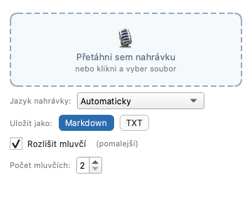

# Voice2Text

[English: README.md](README.md) · Česky: README.cs.md

Offline přepis řeči na text pro počítač. Přetáhneš nahrávku (hlasovou poznámku
z telefonu, poradu, video), aplikace ji přepíše modelem Whisper large-v3 a uloží
přepis jako `.md` nebo `.txt`. Volitelně rozliší, kdo mluví. Nejlépe funguje čeština,
ale přepsat jde každý jazyk, který Whisper umí.

Vše běží na tvém počítači. Po jednorázovém stažení modelu nepotřebuje aplikace
internet a z počítače neodchází nic kromě samotného stažení modelů.

## Požadavky

- macOS 14+ na Apple Silicon (Intel Mac nepodporován), nebo Windows 10/11 64bit (ARM nepodporováno)
- model řeči: asi 3 GB ke stažení, na disku potřeba asi 3,5 GB

## Instalace

Instalátory jsou v [Releases](https://github.com/xxBedy/Voice2Text/releases): `Voice2Text-<verze>.dmg` pro Mac,
`Voice2Text-Setup-<verze>.exe` pro Windows. Aplikace není podepsaná, proto systém
při prvním spuštění varuje.

**macOS:** otevři `.dmg` a přetáhni Voice2Text do složky Aplikace. První spuštění
systém zablokuje: otevři Nastavení systému › Soukromí a zabezpečení, dole u
Voice2Text klikni na „Přesto otevřít“.

**Windows:** spusť `Voice2Text-Setup-<verze>.exe` (nepotřebuje administrátora).
V SmartScreenu klikni na „Další informace“ › „Přesto spustit“.

Rozhraní se řídí jazykem systému (český systém česky, jinak anglicky). Přepsat to
jde proměnnou `VOICE2TEXT_UI_LANG=cs` nebo `en`.

## První spuštění

Aplikace stáhne model řeči (asi 3 GB) a ukazuje průběh. Pak už funguje bez internetu.
Modely pro rozlišení mluvčích (asi 33 MB) se dotahují na pozadí; dokud nejsou
nainstalované, je volba „Rozlišit mluvčí“ šedá. Když stahování nejde (např. ve
firemní síti), použij ruční import níže; tlačítko „Nahrát model ručně…“ je k dispozici
i během stahování a stahování zruší. Firemní kontrola TLS nevadí, aplikace důvěřuje
úložišti certifikátů operačního systému. Najednou běží jen jedno stahování; druhá
instance ohlásí, že je obsazeno.

### Model ručně

Zkopíruj celou složku `models` z počítače, který ji už má:

- macOS: `~/Library/Application Support/Voice2Text/models`
- Windows: `%LOCALAPPDATA%\Voice2Text\models`

Na cílovém počítači zvol „Nahrát model ručně…“ a vyber buď složku s modelem Whisper,
nebo celou složku `models` (naimportuje se model řeči i modely pro mluvčí).

## Použití

1. Nahrávku nejdřív ulož jako soubor. Přetažení přímo z aplikace Diktafon nebo
   z přílohy v Outlooku nefunguje; AirDrop ukládá do Stažených souborů.
2. Přetáhni soubor do okna, nebo na okno klikni a soubor vyber. Dialog nabízí m4a,
   mp3, wav, aac, mp4, flac, ogg, opus, webm, aiff, aif, wma, mov a mkv. Při přetažení
   jde cokoli, co umí přečíst PyAV (FFmpeg), včetně videa. Na Macu se systém při
   prvním přetažení ze Stažených souborů zeptá, jestli aplikace smí do složky;
   povol to, jinak přepis nejde uložit vedle nahrávky.
3. **Jazyk nahrávky:** „Automaticky“ nechá jazyk určit Whisper (zjištěný jazyk se
   pak zobrazí). Seznam nabízí nejběžnější jazyky nahoře, pak všechny ostatní. Volba
   se pamatuje; při prvním spuštění je výchozí jazyk systému. Zvolit jazyk ručně je
   rychlejší a spolehlivější.
4. **Rozlišit mluvčí:** zaškrtni a nastav „Počet mluvčích“ (2 až 6, výchozí 2) podle
   toho, kolik lidí mluví. Automatické zjišťování počtu se neosvědčilo na skutečných
   poradách, proto se nepoužívá. Když se mluvčí rozlišit nepodaří, přepis se uloží
   bez nich a okno to napíše.
5. Přepis se uloží vedle nahrávky jako `.md` nebo `.txt`. Existující soubor se nikdy
   nepřepíše, přidá se ` (2)`. Když složka není zapisovatelná nebo je dočasná
   (např. otevřená příloha), přepis jde do `Dokumenty/Přepisy` (při anglickém
   rozhraní `Documents/Transcripts`).

Přepis používá výkonná jádra procesoru (nejvýše 6 vláken). Jde to změnit proměnnou
`VOICE2TEXT_CPU_THREADS`.

## Logy

`<data aplikace>/logs/voice2text.log` a `worker.log`:

- macOS: `~/Library/Application Support/Voice2Text/logs/`
- Windows: `%LOCALAPPDATA%\Voice2Text\logs\`

Odinstalování na Windows modely a logy nemaže (složka `%LOCALAPPDATA%\Voice2Text` zůstává).

## Příkazová řádka

    Voice2Text --transcribe CESTA [--format md|txt] [--speakers] [--num-speakers N]
               [--language KÓD|auto] [--no-download]

`N` je 2 až 10 (výchozí 2); `KÓD` je kód jazyka Whisper, např. `cs` nebo `en`
(výchozí `auto`). Při úspěchu se vypíše cesta k přepisu. Návratové kódy:

| Kód | Význam |
| --- | --- |
| 0 | hotovo |
| 1 | jiná chyba (neplatný jazyk, neplatný počet mluvčích, neznámý přepínač, chybějící model s `--no-download`, selhané stahování, chyba úlohy) |
| 2 | nečitelný soubor nebo chyba použití příkazové řádky hlášená parserem (např. neplatný `--format` nebo `--num-speakers`, které není celé číslo) |
| 3 | žádná řeč |

## Soukromí

Nahrávky ani přepisy neopouštějí tvůj počítač. Jediný síťový provoz je stažení
modelů uvedených níže z Hugging Face a GitHubu.

## Licence

Voice2Text je pod [licencí MIT](LICENSE), copyright (c) 2026 Martin Bednář.

Příručka pro vývojáře: [docs/development.cs.md](docs/development.cs.md).

### Modely třetích stran

Aplikace tyto modely nedodává, stahuje je za běhu. Každý má vlastní licenci.

| Model | K čemu | Licence | Zdroj |
| --- | --- | --- | --- |
| Systran/faster-whisper-large-v3 (konverze OpenAI Whisper large-v3 pro CTranslate2) | rozpoznání řeči | MIT | [karta modelu](https://huggingface.co/Systran/faster-whisper-large-v3) |
| OpenAI Whisper large-v3 (původní model) | | Apache-2.0 | [karta modelu](https://huggingface.co/openai/whisper-large-v3) |
| pyannote segmentation-3.0, ONNX verze ze sherpa-onnx | segmentace mluvčích | MIT | [originál](https://huggingface.co/pyannote/segmentation-3.0), [konverze](https://k2-fsa.github.io/sherpa/onnx/speaker-diarization/models.html) |
| WeSpeaker ResNet34 VoxCeleb, ONNX verze ze sherpa-onnx | otisky hlasů | CC BY 4.0 (WeSpeaker uvádí, že modely natrénované na VoxCeleb se řídí licencí datasetu) | [předtrénované modely WeSpeaker](https://github.com/wenet-e2e/wespeaker/blob/master/docs/pretrained.md), [release](https://github.com/k2-fsa/sherpa-onnx/releases/tag/speaker-recongition-models) |

### Hlavní knihovny

| Knihovna | Licence |
| --- | --- |
| [PySide6 (Qt for Python)](https://doc.qt.io/qtforpython-6/) | LGPL-3.0 |
| [faster-whisper](https://github.com/SYSTRAN/faster-whisper) | MIT |
| [CTranslate2](https://github.com/OpenNMT/CTranslate2) | MIT |
| [sherpa-onnx](https://github.com/k2-fsa/sherpa-onnx) | Apache-2.0 |
| [PyAV](https://github.com/PyAV-Org/PyAV) | BSD-3-Clause |
| [FFmpeg](https://ffmpeg.org/) (součást balíčků PyAV) | součásti LGPL/GPL, viz licenční upozornění FFmpeg/PyAV |

Model mluvčích WeSpeaker pochází z [projektu WeSpeaker](https://github.com/wenet-e2e/wespeaker) (wenet-e2e), licence CC BY 4.0.
