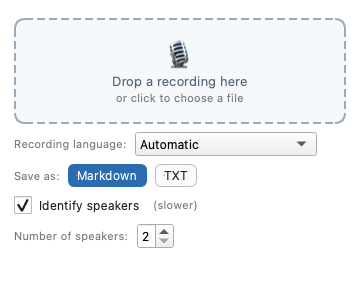

# Voice2Text

English: README.md · [Česky: README.cs.md](README.cs.md)

Offline speech-to-text for your desktop. Drop a recording (a phone voice memo, a
meeting, a video), and the app transcribes it with Whisper large-v3 and saves the
transcript as `.md` or `.txt`. It can optionally label who is speaking.
Czech works especially well, but any language Whisper supports can be transcribed.

Everything runs on your computer. After the one-time model download nothing needs
the internet, and nothing but that download ever leaves your machine.

## Requirements

- macOS 14+ on Apple Silicon (Intel Macs are not supported), or Windows 10/11 64-bit (ARM is not supported)
- about 3 GB to download for the speech model, about 3.5 GB of free disk space

## Install

Download the installer from [Releases](https://github.com/xxBedy/Voice2Text/releases): `Voice2Text-<version>.dmg`
for Mac, `Voice2Text-Setup-<version>.exe` for Windows. The app is not code-signed,
so the system warns you the first time.

**macOS:** open the `.dmg` and drag Voice2Text to Applications. The first launch is
blocked: open System Settings > Privacy & Security, scroll down to Voice2Text and
click "Open Anyway".

**Windows:** run `Voice2Text-Setup-<version>.exe` (no administrator rights needed).
In SmartScreen click "More info" > "Run anyway".

The interface follows the system language (Czech on a Czech system, English
otherwise). Set `VOICE2TEXT_UI_LANG=cs` or `en` to override it.

## First run

The app downloads the speech model (about 3 GB) and shows the progress. After that
it works offline. The speaker models (about 33 MB) are fetched in the background;
until they are installed, the "Identify speakers" checkbox is greyed out. If the
download is blocked (for example on a corporate network), see the next section;
the "Import model manually…" button is available during the download too and
cancels it. Corporate TLS inspection works because the app trusts the operating
system's certificate store. Only one download runs at a time; a second instance
reports "busy".

### Importing the model manually

Copy the whole `models` folder from a computer that already has it:

- macOS: `~/Library/Application Support/Voice2Text/models`
- Windows: `%LOCALAPPDATA%\Voice2Text\models`

On the target computer choose "Import model manually…" and select either a
Whisper model folder or the whole `models` folder (this imports the speech model
and the speaker models together).

## Usage

1. Save the recording as a file first. Dragging straight out of Voice Memos or from
   an Outlook attachment is not supported; AirDrop puts a memo into Downloads.
2. Drag the file into the window, or click it to choose a file. The dialog lists
   m4a, mp3, wav, aac, mp4, flac, ogg, opus, webm, aiff, aif, wma, mov and mkv.
   With drag and drop, anything PyAV (FFmpeg) can read works, including video.
   On macOS the system asks the first time you drop a file from Downloads whether
   the app may access that folder; allow it, otherwise the transcript cannot be
   saved next to the recording.
3. **Recording language:** "Automatic" lets Whisper detect it (the detected language
   is shown afterwards). The list offers the most common languages first, then all
   the others. Your choice is remembered; on the first run it defaults to the system
   language. Choosing the language explicitly is faster and more reliable.
4. **Identify speakers:** tick it and set "Number of speakers" (2 to 6, default 2) to
   the number of people talking. Guessing the count automatically proved unreliable
   on real meetings, so it is not done. If speaker detection fails, the transcript
   is saved without speakers and the window says so.
5. The transcript is saved next to the recording as `.md` or `.txt`. An existing file
   is never overwritten; ` (2)` is added to the name instead. If the folder is not
   writable or is temporary (for example an opened attachment), it goes to
   `Documents/Transcripts` (`Documents/Přepisy` when the interface is Czech).

Transcription uses the performance cores (at most 6 threads).
`VOICE2TEXT_CPU_THREADS` overrides this.

## Logs

`<app data>/logs/voice2text.log` and `worker.log`:

- macOS: `~/Library/Application Support/Voice2Text/logs/`
- Windows: `%LOCALAPPDATA%\Voice2Text\logs\`

Uninstalling on Windows keeps the models and logs (the `%LOCALAPPDATA%\Voice2Text` folder stays).

## Command line

    Voice2Text --transcribe PATH [--format md|txt] [--speakers] [--num-speakers N]
               [--language CODE|auto] [--no-download]

`N` is 2 to 10 (default 2); `CODE` is a Whisper language code such as `cs` or `en`
(default `auto`). The transcript path is printed on success. Exit codes:

| Code | Meaning |
| --- | --- |
| 0 | done |
| 1 | any other error (invalid language, invalid speaker count, unknown option, missing model with `--no-download`, failed download, job error) |
| 2 | unreadable file, or a command-line usage error from the parser (for example an invalid `--format` or a non-integer `--num-speakers`) |
| 3 | no speech found |

## Privacy

Audio and transcripts never leave your computer. The only network traffic is the
download of the models listed below, from Hugging Face and GitHub.

## Licence

Voice2Text is released under the [MIT licence](LICENSE), copyright (c) 2026 Martin Bednář.

Developer guide: [docs/development.md](docs/development.md).

### Third-party models

The app does not ship these models; it downloads them at runtime. Each keeps its own licence.

| Model | Used for | Licence | Source |
| --- | --- | --- | --- |
| Systran/faster-whisper-large-v3 (CTranslate2 conversion of OpenAI Whisper large-v3) | speech recognition | MIT | [model card](https://huggingface.co/Systran/faster-whisper-large-v3) |
| OpenAI Whisper large-v3 (original model) | | Apache-2.0 | [model card](https://huggingface.co/openai/whisper-large-v3) |
| pyannote segmentation-3.0, ONNX build from sherpa-onnx | speaker segmentation | MIT | [original](https://huggingface.co/pyannote/segmentation-3.0), [conversion](https://k2-fsa.github.io/sherpa/onnx/speaker-diarization/models.html) |
| WeSpeaker ResNet34 VoxCeleb, ONNX build from sherpa-onnx | speaker embeddings | CC BY 4.0 (WeSpeaker states that models trained on VoxCeleb follow the dataset licence) | [WeSpeaker pretrained models](https://github.com/wenet-e2e/wespeaker/blob/master/docs/pretrained.md), [release](https://github.com/k2-fsa/sherpa-onnx/releases/tag/speaker-recongition-models) |

### Main libraries

| Library | Licence |
| --- | --- |
| [PySide6 (Qt for Python)](https://doc.qt.io/qtforpython-6/) | LGPL-3.0 |
| [faster-whisper](https://github.com/SYSTRAN/faster-whisper) | MIT |
| [CTranslate2](https://github.com/OpenNMT/CTranslate2) | MIT |
| [sherpa-onnx](https://github.com/k2-fsa/sherpa-onnx) | Apache-2.0 |
| [PyAV](https://github.com/PyAV-Org/PyAV) | BSD-3-Clause |
| [FFmpeg](https://ffmpeg.org/) (bundled in the PyAV wheels) | LGPL/GPL components, see the FFmpeg/PyAV licence notices |

The WeSpeaker speaker model is credited to the [WeSpeaker project](https://github.com/wenet-e2e/wespeaker) (wenet-e2e), licensed CC BY 4.0.
